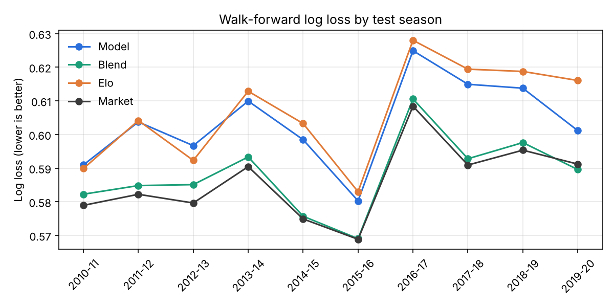

# Backtest results

**Bottom line: nothing here beats the market.** The model is slightly
better than Elo and clearly worse than the no-vig closing line. Adding the
market's own probability doesn't help either: putting the model's features
on top of the closing line makes it *worse*. Betting at closing prices loses
roughly the vig (2–4% per bet).

## Setup

- **Data:** 16,212 NBA games, 2007-08 to January 2020 (regular season and
  playoffs), with final scores and closing moneylines from the Sports Book
  Reviews archive. 16,200 have a usable two-way closing line (average vig
  3.8%). One overtime game whose final score is missing was dropped, and one
  known score typo was fixed.
- **Walk-forward:** test seasons are 2010-11 to 2019-20. Each is predicted by
  models trained only on earlier seasons, starting at 2008-09. 2007-08 is
  warm-up for Elo and team stats only.
- **Scored on:** the 12,260 test games that have a closing line.

| Name | What it is |
|---|---|
| **Model** | Logistic regression on pre-game features only (no market info): Elo difference, season-to-date win % and margin, last-10 margin, rest difference, back-to-backs, 3-in-4 nights, travel distance, time-zone change, altitude, neutral site, playoffs |
| **Blend** | Same, plus the market's no-vig probability (as log-odds) as a feature. Tests whether the features add anything *on top of* the market |
| **Mkt recal** | The market's log-odds alone, refit each season. Tests whether the closing line has a systematic bias (e.g. underdogs overpriced) |
| **Elo** | K=20, 100-point home advantage, margin-of-victory multiplier, 1/4 reversion to the mean per season; settings not tuned |
| **Market** | No-vig closing probability (vig removed proportionally) |

## Probability quality

Log loss: lower is better, and a coin flip scores 0.693.

| Season | Games | Model | Blend | Mkt recal | Elo | **Market** |
|---|---|---|---|---|---|---|
| 2010-11 | 1310 | 0.5910 | 0.5823 | 0.5788 | 0.5899 | 0.5789 |
| 2011-12 | 1074 | 0.6037 | 0.5848 | 0.5821 | 0.6042 | 0.5822 |
| 2012-13 | 1306 | 0.5967 | 0.5851 | 0.5795 | 0.5923 | 0.5796 |
| 2013-14 | 1318 | 0.6099 | 0.5933 | 0.5906 | 0.6129 | 0.5904 |
| 2014-15 | 1311 | 0.5985 | 0.5757 | 0.5747 | 0.6033 | 0.5749 |
| 2015-16 | 1316 | 0.5803 | 0.5690 | 0.5692 | 0.5830 | 0.5688 |
| 2016-17 | 1309 | 0.6249 | 0.6106 | 0.6095 | 0.6280 | 0.6084 |
| 2017-18 | 1312 | 0.6149 | 0.5928 | 0.5910 | 0.6194 | 0.5909 |
| 2018-19 | 1312 | 0.6138 | 0.5976 | 0.5958 | 0.6187 | 0.5953 |
| 2019-20* | 692 | 0.6012 | 0.5896 | 0.5909 | 0.6161 | 0.5912 |
| **All** | 12260 | 0.6036 | 0.5881 | 0.5861 | 0.6064 | **0.5859** |

Brier scores over all test games, where a coin flip scores 0.25 and lower is better:

| Model | Blend | Mkt recal | Elo | Market |
|---|---|---|---|---|
| 0.2084 | 0.2017 | 0.2009 | 0.2096 | 0.2009 |

Per-season Brier scores are in `reports/metrics_by_season.csv`.

\* 2019-20 data ends in late January 2020.

Paired log-loss differences per game, with bootstrap 95% CIs:

| Comparison | Difference | 95% CI | Reading |
|---|---|---|---|
| Model − Elo | −0.0028 | [−0.0047, −0.0008] | Model beats Elo (small, real) |
| Blend − Market | +0.0022 | [+0.0008, +0.0036] | Adding features to the market makes it **worse** |
| Mkt recal − Market | +0.0002 | [−0.0003, +0.0006] | No exploitable bias in the closing line |

## What the market already knows

Logistic-regression weights (standardized), fit on 2008-09 to 2018-19:

| Feature | Model (no market) | Blend (with market) |
|---|---|---|
| Market log-odds | — | **0.956** |
| Elo difference | **0.698** | 0.137 |
| Season-to-date margin | 0.251 | 0.044 |
| Home team on a back-to-back | −0.069 | −0.008 |
| Away team on a back-to-back | +0.097 | −0.004 |
| Travel difference (per 1000 km) | +0.046 | +0.054 |
| Away time-zone change | +0.027 | +0.024 |
| Altitude (DEN/UTA at home) | +0.040 | +0.025 |

- **Rest and form are priced in.** Back-to-backs matter on their own, but
  their effect disappears once the market probability is included.
- **Travel, time-zone and altitude look like noise.** They keep small weights
  in the blend, but the blend scores worse than the market out of sample.
  Adding the schedule features also made the standalone model slightly worse
  (0.6036 vs 0.6028 without them).

## Betting simulation

Flat 1-unit bets at the closing moneyline. In each game, bet the side with the
higher expected value, if that EV is above the threshold. CIs are bootstrap 95%.

| Probabilities | EV threshold | Bets | Win rate | Profit (units) | ROI | ROI 95% CI |
|---|---|---|---|---|---|---|
| Model | 0% | 9748 | 42.3% | −273.2 | −2.8% | [−5.9%, +0.3%] |
| Model | 5% | 7161 | 37.8% | −165.6 | −2.3% | [−6.0%, +1.5%] |
| Model | 10% | 5288 | 33.3% | −220.5 | −4.2% | [−8.9%, +0.4%] |
| Blend | 0% | 5000 | 49.9% | −102.8 | −2.1% | [−5.6%, +1.4%] |
| Blend | 2% | 3092 | 46.3% | −81.2 | −2.6% | [−7.3%, +1.9%] |
| Blend | 5% | 1526 | 41.1% | −34.7 | −2.3% | [−9.3%, +5.2%] |
| Blend | 10% | 577 | 38.8% | +35.1 | +6.1% | [−7.1%, +20.5%] |
| Mkt recal | 0% | 98 | 68.4% | +0.1 | +0.1% | [−13.8%, +12.9%] |
| Elo | 0% | 10022 | 43.4% | −292.9 | −2.9% | [−5.8%, 0.0%] |
| Always bet home | — | 12260 | 58.9% | −495.6 | −4.0% | [−5.7%, −2.3%] |
| Always bet favorite | — | 12260 | 68.6% | −504.9 | −4.1% | [−5.3%, −3.0%] |

All thresholds are in `reports/betting_summary.csv`.

- **No strategy made reliable money.** None tripped the 10% ROI alarm.
- **The +6.1% for Blend at 10% is noise.** Its interval runs from −7% to
  +20%, it's the best of 16 strategy and threshold combinations, and the
  Blend's probabilities are measurably worse than the market's.
- **Mkt recal almost never bets.** Its re-fitted probabilities rarely
  disagree with the market by more than the vig, which confirms the closing
  line is well calibrated.
- **Betting blindly at the close loses about the vig** (about 4%), which
  confirms the odds math and settlement are wired up correctly.

## Checks performed

- **Pipeline (all automated tests, 85 in total):**
  - Each game's result was flipped in turn; no Elo probability or feature,
    including the travel and schedule ones, changed for that game or any
    earlier game.
  - Every model is trained strictly on seasons before its test season (asserted in code).
  - A deliberately leaked result pushes ROI past the 10% alarm, so the alarm works.
  - On simulated data where the market equals the true probabilities, no
    model beats it.
- **Data:**
  - Rows pair correctly into games, team names are all recognised, and every
    final score is at least the sum of its quarters.
  - Lines whose vig falls outside 0–10% are dropped.
  - The market's average home-win probability (0.595) matches the actual
    home-win rate (0.594).

## What could change the answer

The closing line already reflects everything that can be computed from
schedules and past scores. A real edge would need information the market
is slow to absorb, or better prices than the close:

1. **Injuries and lineups**: who actually plays, and late scratches.
   Player-level data (on/off ratings, minutes) is the most likely source of signal.
2. **Earlier prices.** Opening moneylines let you test whether the model
   predicts where the line *moves*, which is a more realistic betting setup
   than betting at the close.
3. **Newer seasons.** This data ends in January 2020. Testing on recent
   seasons needs a historical odds source (most are paid, with a key in `.env`).
