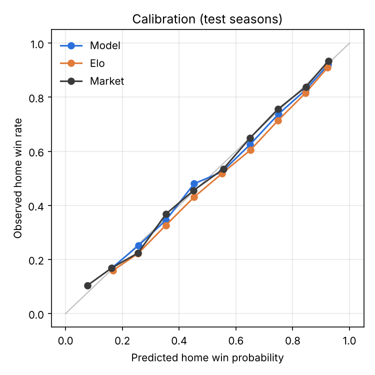
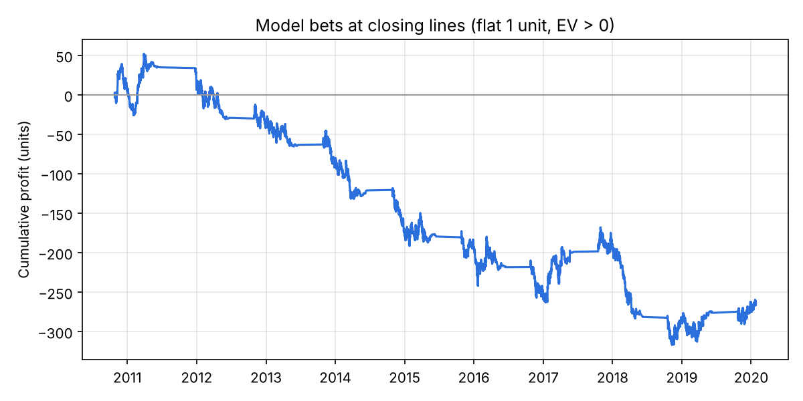

# Backtest results

**Bottom line: the model does not beat the market.** It is slightly better
than Elo, clearly worse than the no-vig closing line, and betting it at
closing prices lost about 3% per bet. That is roughly the bookmaker's vig,
which is what you'd expect from a model with no real edge.

## Setup

- **Data:** 16,212 NBA games, 2007-08 to January 2020 (regular season and
  playoffs), with final scores and closing moneylines from the Sports Book
  Reviews archive. 16,200 have a usable two-way closing line (average vig
  3.8%). One overtime game whose final score is missing was dropped, and one
  known score typo was fixed.
- **Walk-forward:** test seasons are 2010-11 to 2019-20. Each is predicted by a
  model trained only on earlier seasons, starting at 2008-09. 2007-08 is
  warm-up for Elo and team stats only.
- **Model:** logistic regression on pre-game features: Elo difference,
  rest-day difference, back-to-backs, season-to-date win % and point margin,
  last-10 margin, neutral site, playoffs.
- **Baselines:** Elo (K=20, 100-point home advantage, margin-of-victory
  multiplier, 1/4 reversion to the mean each season; settings not tuned) and
  the market's no-vig closing probability.
- **Scored on:** the 12,260 test games that have a closing line.

## Probability quality

Lower is better for both metrics. A coin flip scores 0.693 log loss and 0.25 Brier.

| Season | Games | Model LL | Elo LL | Market LL | Model Brier | Elo Brier | Market Brier |
|---|---|---|---|---|---|---|---|
| 2010-11 | 1310 | 0.5875 | 0.5899 | **0.5789** | 0.2012 | 0.2023 | **0.1973** |
| 2011-12 | 1074 | 0.6027 | 0.6042 | **0.5822** | 0.2080 | 0.2083 | **0.1992** |
| 2012-13 | 1306 | 0.5965 | 0.5923 | **0.5796** | 0.2043 | 0.2038 | **0.1982** |
| 2013-14 | 1318 | 0.6081 | 0.6129 | **0.5904** | 0.2105 | 0.2128 | **0.2035** |
| 2014-15 | 1311 | 0.5986 | 0.6033 | **0.5749** | 0.2065 | 0.2084 | **0.1965** |
| 2015-16 | 1316 | 0.5783 | 0.5830 | **0.5688** | 0.1978 | 0.1994 | **0.1938** |
| 2016-17 | 1309 | 0.6243 | 0.6280 | **0.6084** | 0.2175 | 0.2192 | **0.2106** |
| 2017-18 | 1312 | 0.6152 | 0.6194 | **0.5909** | 0.2133 | 0.2148 | **0.2030** |
| 2018-19 | 1312 | 0.6144 | 0.6187 | **0.5953** | 0.2130 | 0.2149 | **0.2044** |
| 2019-20* | 692 | 0.6025 | 0.6161 | **0.5912** | 0.2084 | 0.2141 | **0.2028** |
| **All** | 12260 | 0.6028 | 0.6064 | **0.5859** | 0.2081 | 0.2096 | **0.2009** |

\* 2019-20 data ends in late January 2020.

Paired differences in log loss per game, with bootstrap 95% CIs:
- **Model vs Elo:** −0.0035 [−0.0054, −0.0017]. The model is better, and the gap is statistically real but small.
- **Model vs market:** +0.0169 [+0.0135, +0.0203]. The market is clearly better in every season.

All three are well calibrated. The market wins on sharpness: it separates
strong and weak teams more confidently and correctly.

## Betting simulation

Flat 1-unit bets at the closing moneyline. In each game, bet the side with the
higher expected value under the model, if that EV is above the threshold.
CIs are bootstrap 95%.

| Probabilities | EV threshold | Bets | Win rate | Profit (units) | ROI | ROI 95% CI |
|---|---|---|---|---|---|---|
| Model | 0% | 9685 | 42.4% | −266.4 | −2.8% | [−5.8%, +0.4%] |
| Model | 2% | 8509 | 40.4% | −203.4 | −2.4% | [−5.7%, +1.1%] |
| Model | 5% | 7010 | 37.5% | −184.5 | −2.6% | [−6.5%, +1.2%] |
| Model | 10% | 5135 | 33.3% | −196.1 | −3.8% | [−8.3%, +1.3%] |
| Elo | 0% | 10022 | 43.4% | −292.9 | −2.9% | [−5.8%, 0.0%] |
| Elo | 10% | 5818 | 35.2% | −151.1 | −2.6% | [−7.0%, +1.8%] |
| Always bet home | — | 12260 | 58.9% | −495.6 | −4.0% | [−5.7%, −2.3%] |
| Always bet favorite | — | 12260 | 68.6% | −504.9 | −4.1% | [−5.3%, −3.0%] |

- **No strategy made money.** None came near the 10% ROI alarm, so there's
  no sign of leakage.
- **Bigger "edges" don't help.** Raising the EV threshold doesn't improve
  ROI, so the model's disagreements with the market are noise rather than
  information.
- **Mostly underdog bets.** 65% of the model's bets are on market
  underdogs. Its probabilities are less extreme than the market's, so it
  keeps "finding value" on longshots.
- **Betting blindly at the close loses about the vig** (about 4%), which
  confirms the odds math and settlement are wired up correctly.

## Checks performed

- **Pipeline (all automated tests, 80 in total):**
  - Each game's result was flipped in turn; no Elo probability or feature for
    that game or any earlier game changed.
  - Every model is trained strictly on seasons before its test season (asserted in code).
  - A deliberately leaked result pushes ROI past the 10% alarm, so the alarm works.
  - On simulated data where the market equals the true probabilities, the
    model can't beat it.
- **Data:**
  - Rows pair correctly into games, team names are all recognised, and every
    final score is at least the sum of its quarters.
  - Lines whose vig falls outside 0–10% are dropped.
  - The market's average home-win probability (0.595) matches the actual
    home-win rate (0.594).

## Caveats and what could change the answer

- **Betting at the close is optimistic.** In practice you bet earlier, at
  a worse or better price. Opening lines are in the raw data (`Open` is a
  spread/total, not a moneyline), so true opening moneylines would need
  another source.
- **The data is old.** It ends in January 2020. Newer seasons need another
  odds source (e.g. a paid historical odds API, with a key in `.env`).
- **Features are basic.** There's nothing on injuries, rest decisions,
  lineups or travel, which is the information the market prices in and
  this model doesn't have. Player-level data is the most likely place to
  find real signal.
